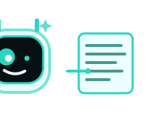

# DevLens

<div align="center">

[English](README.md) | [简体中文](docs/locales/README_zh-CN.md) | [繁體中文](docs/locales/README_zh-TW.md) | [한국어](docs/locales/README_ko.md) | [Deutsch](docs/locales/README_de.md) | [Español](docs/locales/README_es.md) | [Français](docs/locales/README_fr.md) | [Italiano](docs/locales/README_it.md) | [Dansk](docs/locales/README_da.md) | [日本語](docs/locales/README_ja.md) | [Polski](docs/locales/README_pl.md) | [Русский](docs/locales/README_ru.md) | [Bosanski](docs/locales/README_bs.md) | [العربية](docs/locales/README_ar.md) | [Norsk](docs/locales/README_no.md) | [Português (Brasil)](docs/locales/README_pt-BR.md) | [ไทย](docs/locales/README_th.md) | [Türkçe](docs/locales/README_tr.md) | [Українська](docs/locales/README_uk.md) | [বাংলা](docs/locales/README_bn.md) | [Ελληνικά](docs/locales/README_el.md) | [Tiếng Việt](docs/locales/README_vi.md)

</div>

<p align="center">
  
</p>

<p align="center"><em>Lensy keeps an eye on both viewports.</em></p>

A workflow-native developer browser: one URL previewed in two device frames at once, with a
live console/network feed, an HTTP interceptor and repeater, live design/CSS overrides, a
recon report and a provider-hosted AI assistant - plus one-click hand-off to your editor.

Built with Electron 44, Vite 7, React 19, TypeScript (strict) and Tailwind CSS 4.

The current build also includes an embedded Chrome DevTools Protocol inspector, a JavaScript
REPL, editable profile-scoped hotkeys, direct Launchpad customization and guided Private/WImH
privacy explanations.

## Quick start

```bash
npm install
npm run dev
```

`npm run dev` builds the main process and both preload bridges, starts the Vite dev
server for the UI shell and launches Electron with hot reload. A fresh profile opens
the DevLens Launchpad by default; New Tab and Homepage targets can be changed under
`devlens:settings/home`.

| Script | What it does |
| --- | --- |
| `npm run dev` | Vite dev server + Electron with HMR (development) |
| `npm run build` | Typechecks all three TS projects, then builds `out/` |
| `npm run start` | Runs the built app (`out/`) without the dev server |
| `npm run typecheck` | `tsc --noEmit` for main, preload and renderer |

### Verification

The verification harness is outside the application directory at `work/verify/`. Run these
commands from the workspace root (the parent of `outputs/devlens`). They use isolated
user-data directories and fixture servers:

```bash
node work/verify/verify-repair.mjs
node work/verify/verify-profiles.mjs
node work/verify/verify-about.cjs
node work/verify/verify-downloads.cjs
node work/verify/verify-downloads-electron.cjs
node work/verify/verify-fonts.mjs
node work/verify/verify-browser-icons.mjs
node work/verify/verify-app-icons.cjs
node work/verify/verify-app-icons-electron.cjs
node work/verify/verify-wallpapers.cjs
node work/verify/verify-developer-quotes.cjs
node work/verify/verify-browsing-data.mjs
node work/verify/verify-startup-tabs.mjs
```

The current regression baseline is 63/63 settings/dashboard checks, 23/23 profile checks and
11/11 About checks, plus the focused icon, wallpaper, quote, download, font and browsing-data
suites described below.

<p align="right">
  
  <br />
  <sub>Lensy checked the tests too.</sub>
</p>

## What is implemented

**Dual-viewport canvas.** The same URL renders in a Mobile frame (375x812 by default,
scale-to-fit so the true CSS viewport is preserved) and a Desktop frame that fills the
canvas or takes an explicit width (1440/1280/1024). Device presets: iPhone 13, Pixel 7,
iPhone SE. Both frames share one Electron session, so logins and cookies carry over.
This mode applies to web pages only: the front page and every `devlens:` route always use the
full canvas, with no device picker, fold control, viewport chip or split frame.

**Scroll sync.** A guest bridge (see `src/preload/webview.ts`) reports its scroll ratio
and applies the twin's ratio on request. Reports are trailing-throttled so a programmatic
jump can never be dropped, change-gated so an idle page costs nothing, and backed by a
100 ms sampler because Chromium does not always dispatch scroll events to a frame the
compositor is not driving (a scaled viewport is a good example). The sync toggle in the
toolbar turns the whole path off.

**Elements inspector.** The Elements tool connects to the active guest through the Chrome
DevTools Protocol and presents a live DOM tree. Selecting an element shows its attributes,
outer HTML, matched styles, computed styles and box model. Attributes, HTML and editable CSS
rules can be applied back to the page, and `refresh` re-reads the document after framework
changes. The panel can also hand the guest to a separate external DevTools window.

**Console and JavaScript REPL.** The main process instruments every webview `webContents`
(`console-message`, navigation lifecycle) and tags each event with its viewport. The Console
tool filters by event kind, level and text, expands source details, and can hand a source
location to the editor. Its REPL evaluates expressions in the active guest with
`Runtime.evaluate`, awaits promises, shows thrown errors and keeps command history.

**Network workflow.** The shared session's `webRequest` hooks capture requests, status,
timing, request and response headers, MIME type, cache state and body previews. The Network
tool filters that capture and hosts the interceptor and repeater described below.

**AI assistant.** The sidebar opens the official web chat for the selected provider: Google
Gemini, DeepSeek, ChatGPT or Anthropic Claude. Each provider has its own persistent partition
per profile, so accounts and sessions do not leak between providers or browsing profiles.
`Summarise page` composes the current page title, active URL and captured developer context
into the provider's own prompt field without sending it. The separate local `aiAsk` pipeline
is still available as an IPC capability for context-aware answers in Dev Mode, but it is not
the assistant panel's primary interface.

**Live design & CSS overrides.** Design mode flips `document.designMode` inside the active
viewport (or both) so text and structure can be edited in place, with a hover outline so it
is obvious what is editable. The CSS editor injects your rules through
`webview.insertCSS()`, keeps them separate from the page's own stylesheets, replays them
after every navigation, and can copy or export the snippet as a `.css` file.

**HTTP interceptor and repeater.** Every request from both viewports is captured (method,
status, duration, headers, body preview) and streamed to the Capture segment. Rules match
the full URL - a pattern with `*` is a glob, anything else a substring:

- `block` cancels the request before it is sent,
- `set-header` / `remove-header` rewrite outgoing headers,
- `redirect` swaps the URL,
- `pause` (and the "hold all" switch) holds the request before it goes out, so you can edit
  its headers and then `Resume` or `Drop` it. Held requests auto-resume after
  `interceptor.pauseTimeoutMs` so a forgotten hold can never wedge a page.

The Repeater sends a request from the main process with a custom method, URL, headers and
body, and shows the response. Payload editing lives there on purpose: Electron's
`webRequest` exposes request bodies for reading but has no API to rewrite one that is
already in flight.

**Recon and report generator.** An asset sniffer folds the capture into hosts, endpoints
(with query parameter names), assets by type, failures and console output, and derives
small observations (plain HTTP target, authentication surface, state-changing endpoints,
5xx responses, third-party origins). The panel renders the report live and exports it as
Markdown or JSON - either through a save dialog or straight into `report.outputDir`.

**Application inspector.** The Application tool reads the active session and document rather
than a separate mock store. It lists cookies, `localStorage`, `sessionStorage` and Cache
Storage for the current origin. Storage keys can be added or edited, individual entries and
caches can be removed, HTTP cache can be cleared without touching cookies, and
`Clear site data` removes this origin's cookies and site storage together.

**Open in editor / click-to-source.** Developer workspace detects installed VS Code-compatible
editors from system URI registrations (VS Code, Insiders, VSCodium, Cursor, CodeBuddy, CodeBuddy
CN, Trae and Windsurf). A switch disables the whole hand-off and greys out the editor dropdown;
the dropdown stores the choice per profile, and the toolbar label follows the selected editor.
The hand-off opens the configured entry file through that
editor's URI scheme (`editor://file/<absolute path>:<line>`). "Open source" on a console row maps
the message's URL back to a file: `file://` URLs resolve directly, and
`http://localhost:<port>/...` URLs resolve inside the configured workspace root (directory URLs
fall back to `index.html`). Paths are never allowed to escape the workspace root.

**Smart omnibox.** One field for addresses, searches and commands (see
[Omnibox](#omnibox)). It detects addresses vs queries, offers a Firefox-style suggestion
list from history, bookmarks, this session's traffic and prefix hints, ranks it locally by
match quality, frequency and recency, and paints the top match's remainder as inline ghost
text. Arrow keys move the highlight, Tab or Right-arrow accepts a completion into the field,
Enter runs the highlighted entry (or whatever the raw text parses to) and Escape closes the
list.

**Floating page tabs.** Each page gets a detached, rounded-top tab that merges into the
content frame when active. The default strip scrolls horizontally; Appearance/Tabs can
switch it to a vertical tab rail for wide-screen development. Its trailing `+` is the
same new-tab-page action as `Ctrl/Cmd+T`. `devlens:settings/tabs` also controls whether
new links switch immediately or open in the background, whether external links land beside
the current tab, and whether `Ctrl+Tab` follows MRU order.
`Alt/⌘/Ctrl+Enter` in the omnibox, and `Alt/⌘/Ctrl`-click or a middle click on a dashboard card,
open the target in its own tab.

Tab favicons follow Chromium's `page-favicon-updated` event rather than waiting for a static DOM
scan. Main downloads the winning candidate and pushes an IPC-safe `data:` URL to every tab on the
same host. Fallback order is the page-declared icon, `/favicon.ico`, then Google's favicon endpoint
for public hosts. The renderer accepts only valid local image data URLs; the letter avatar appears
only when no valid icon exists or the image actually fails to decode.

The tab strip is also the top of the window. DevLens runs frameless (`titleBarStyle: 'hidden'`,
with the OS window buttons drawn as an overlay on Windows and Linux and traffic lights inset on
macOS), so nothing - no application name, no title bar - sits above the tabs. The window keeps
its title for the taskbar and the window switcher, and the strip is marked as the drag region
(`.nova-drag`) while its tabs and the `+` button opt out (`.nova-no-drag`): dragging the empty
part of the strip moves the window and every control stays clickable.

The strip owns the new-tab button: there is exactly one `+`, immediately to the right of the last
tab, the way Chrome and Firefox place theirs. Closing a tab is the full set of gestures people
expect: the chip's `×`, **Ctrl/Cmd+W** for the active tab, and a **middle click** on any chip for
that chip alone. Ctrl+W is handled by the shell, not the application menu - the Window menu's
Close item carried the same accelerator and closed the whole browser instead of the tab, so that
accelerator is gone and the window only goes when the last tab does.

Every tab owns its own viewports, and they stay alive while the tab is in the background - a tab
switch only changes which one is visible. That is what keeps a page's DOM, its scroll position
and its history intact when you switch away and back, and it is why nothing typed into a new tab
can touch the tab that was on screen before: a new tab is a new tab, not an overlay. Closing a
tab destroys exactly that tab's views and hands the window to its neighbour. `Ctrl/Cmd+L` focuses
the address bar from anywhere, which matters on the new tab page because it is a page.

**Split View.** Switching repeatedly between the same two web tabs - at least three times within
15 seconds - raises a compact suggestion under the omnibox. Accepting it places both existing tab
views side by side without reloading either page. The tab context menu also offers Side by Side
and Stacked layouts with the nearest eligible neighbour. Closing either tab, unloading it,
navigating it to a system page, selecting an unrelated tab, or pressing the toolbar split button
 ends the layout while preserving the frames still open. Dismissing the suggestion, or accepting it for that pair, starts a 10-minute cooldown so the same two tabs do not prompt again; a focused omnibox postpones the popup until typing finishes.

**Tab groups.** The tab context menu's `Add to Group` submenu can create a named, colour-coded
group or move a tab into an existing group; tabs already in one also get a remove action. Tabs
can be dragged onto a group header to join it. The header shows the group colour and member
count, and clicking it collapses or expands the member tabs. Group definitions (name, colour and
collapsed state) live in the profile's Tabs preferences, while each restored session tab stores
its `groupId`, so the association returns with the saved session. Both horizontal and vertical
tab layouts implement the same group model.

**Workspace modes.** DevLens is either a clean browser or a developer workspace, and the
switch is enforced rather than drawn: see [Modes](#modes) and
[Profiles](#profiles).

**Editable hotkeys.** `devlens:settings/hotkeys` records new chords directly from the
keyboard, rejects conflicts with another action, and can reset one binding or all of them.
System and developer actions are grouped separately, and the bindings are stored per profile.
The same resolver handles shortcuts while the shell or a guest page has focus.

## Modes

The toolbar carries a two-state switcher. In Dev Mode, `Cmd/Ctrl+Shift+D` returns to Normal
Mode; the visible switcher is the deliberate way into Dev Mode from a Normal Mode session.
The status bar names the active mode. The table in `src/shared/mode.ts` is the single source
of truth: the main process uses it to decide what it enforces, and the renderer uses it to
decide what it offers.

| | Normal Mode (Max Privacy & Immersion) | Dev Mode (Weaponised Workspace) |
| --- | --- | --- |
| Layout | One clean pane, no frame chrome, no side panels | Dual viewport for web pages; system pages use the full canvas |
| Toolbar | Navigation, omnibox, profiles, dashboard | Adds scroll sync, "Open in editor", sidebar toggle |
| Dock | The everyday four: AI assistant, bookmarks, history, settings | Expands to the whole toolset below |
| Panels | Everyday ones only: AI assistant, bookmarks, history, settings | Everything, including the developer tools |
| Hotkeys | System and privacy bindings work normally; invoking an Elements, Console, Network or Sidebar developer binding explicitly requests Dev Mode | Default developer chords are available in the workspace and every binding can be customized |
| Capture | Off in the main process: no console messages, no request records, no failure log | Full capture, rules, hold/resume, repeater |
| Rules | Suspended, even when rules exist and are enabled | Applied |
| Authoring | The guest refuses design mode and the DOM finder itself | `insertCSS`, design mode and `& selector` work |
| AI | The assistant panel embeds the provider's site in both modes; DevLens's own prompt pipeline (captured context) answers only in dev mode | Streams answers with the captured context attached |
| Privacy | Tracker blocklist on, because "max privacy" should not need a panel | Profile traffic left alone so you see what the page does |

The indicator is deliberately asymmetric: normal mode is a muted shield and the words
`Normal Mode (Max Privacy & Immersion)`, dev mode is a lime terminal badge on an accented
rail. Panels are hidden in normal mode, but the enforcement that matters happens in the main
process and in the guest's own bridge - hiding a panel is presentation, not security.

### Normal mode surface and boundaries

Normal mode removes the developer *surface* and keeps monitoring off until the operator changes
mode. It does not mount hidden panels or expose page-controlled paths into Dev Mode:

- The dock offers the everyday four and nothing else - the list comes from `DOCK_TOOLS` in
  `src/shared/mode.ts`, so a developer tool is not hidden by CSS in normal mode, it is not in the
  rail. The panel column starts closed, and the resize handle only exists while it is open.
- The toolbar drops the sidebar toggle, scroll sync, "Open in editor" and the active-viewport
  badge. What remains is navigation, the omnibox, the bookmark star, the WImH shield, the mode
  switcher and the profile menu.
- Every path that could open the developer area goes through one guarded helper that no-ops in
  normal mode, so the omnibox commands (`>design`, `>intercept`) are refused with a reason
  rather than opening anything. `>sec` and `>defense` are the deliberate exception: they
  summon the defense overlay below, which is privacy rather than monitoring.
- Configurable developer hotkeys are explicit commands. The default Elements, Console, Network
  and Sidebar chords switch to Dev Mode before opening their target; Ghost and WImH work without
  exposing a monitoring panel. The `Ctrl/Cmd+Shift+D` developer shortcut and page guest cannot
  switch modes by themselves. To keep a Normal Mode session free of accidental mode changes,
  use the profile's Hotkeys page to avoid or rebind developer chords.
- Electron's own menu carries the DevTools accelerator, so normal mode runs with an
  Edit + Window menu and gets the View menu back in dev mode.
- The status bar drops the workspace path, the capture counters and the DevTools button.
- The start page drops the monitoring counters, the workspace list and its editor hand-off.
  Recent pages, local quick bookmarks and browser prefixes (`@`, `#`, `*`, `:port`,
  `:clear-cache`, `:sandbox`, `:wimh`) stay because they are browsing and privacy features,
  not monitoring.

## The dock

A vertical rail on the left of the canvas, and the one piece of chrome both modes share. What it
offers is one table in `src/shared/mode.ts` (`DOCK_TOOLS`), the same table the panel-availability
answer comes from, so a tool cannot appear in the rail unless its mode allows it.

| Every mode | Dev mode only | Pinned |
| --- | --- | --- |
| AI assistant, Bookmarks, History | Elements, Console, Network, Local dev servers, Device viewport (RWD), Live design & CSS, Application, Recon & report, Extreme defense mode | Settings |

The Console, Elements and Network tools inspect the active viewport's guest rather than the
DevLens shell. Elements covers DOM and CSS, Console covers logs and JavaScript evaluation, and
Network combines traffic capture with interception and replay. Application covers session and
document storage. Keeping those surfaces separate makes their target explicit and avoids one
long panel that changes meaning according to which segment was last selected.

Clicking a tool opens its panel beside the rail; clicking the one that is already showing closes
it again, and the panel is resizable by dragging its outer edge. Switching modes re-filters the
rail in the same process - no restart - and entering normal mode closes a developer panel rather
than leaving it behind: hiding a panel is presentation, but leaving it open would be the leak the
mode exists to prevent.

The panel column is a single `<aside>` with two placements. Normally it is a column; when the AI
panel is open *and* a mobile viewport has focus in dev mode, it becomes a floating panel in the
corner of the canvas, so reading an answer never means giving up the frame you were checking.

### AI assistant

The ✨ tool opens **the provider's own chat, embedded and nothing else** - Google Gemini, DeepSeek,
ChatGPT or Anthropic Claude, chosen from the header dropdown. There is no built-in model and no
second transcript: the conversation, the account and the model choice are the official web UI's,
and DevLens contributes exactly two in-panel capabilities.

Google account authentication is the exception. Google deliberately rejects OAuth in embedded
Chromium/Electron webviews, including a separate Electron `BrowserWindow`; trying to disguise the
browser fingerprint would be both unreliable and inappropriate. The panel states this directly
and `Open in browser` hands Gemini to the operating system's default browser. That browser's
encrypted cookie store cannot be copied back into DevLens's isolated partition, so Google account
sign-in remains an external flow rather than an in-panel session.

The same boundary applies outside the AI panel: guest navigation or `window.open` to Google's
account hosts is denied inside Electron and handed to an installed Chrome, Edge, Firefox or Brave
executable. On Windows DevLens resolves those executables directly instead of calling the default
handler, because DevLens itself may be the default browser and would otherwise reopen the same
embedded page.

1. **Isolation.** Each provider gets its own persistent partition
   (`persist:devlens-ai-<profile>-<provider>`), so a login to one cannot see another, none of them
   can see the browsing profile's session, and the choice of provider is stored *per profile* -
   the assistant someone opened in "Work" is not the one they opened in "Personal".
2. **"Summarise page".** One action in the header. It composes a prompt from the page in front,
   its title and any captured context, copies it to the clipboard, and then tries to *type it into
   the site's own composer* - the largest editable field on the page, set through the native
   setter so the site's framework notices. Nothing is sent: the operator reads it and presses
   their own Enter. When there is no composer to find - a site that has not finished loading, or
   one that keeps its input somewhere unusual - the prompt is still on the clipboard and the
   status line says so.

The dock's ✨ button wears the brand of whichever provider this profile last used, so the rail
answers "which assistant am I about to open" before you click it. The marks are drawn inline
rather than fetched: a dock icon that needs a CDN is a dock icon that is blank offline.

DevLens's own AI pipeline - the one that attaches captured console and network context to a
prompt and streams an answer - still exists behind `aiAsk` and is still refused outside dev mode,
because it has nothing to attach when nothing is captured. The assistant panel no longer drives
it: the panel is a window onto the site, not a competitor to it.

<p align="right">
  
</p>

## Protection levels

The security badge in the toolbar is the browser's privacy dial - click it and pick a level. It
is a browser control rather than a developer one, so it is available in both modes, and the badge
always shows the mode and the level it is running: `Normal Mode (Standard)`,
`Normal Mode (Strict)`, `Normal Mode (Extreme)`, `Dev Mode (Strict)`, and so on.

| Level | What changes |
| --- | --- |
| Standard Defense | The base tracker list stays on. Nothing else is touched, so page scripts, storage and headers are exactly what the site wrote. |
| Strict Privacy | Everything in Standard, plus the aggressive list (beacons, tracking pixels, ad exchanges, session-replay vendors, product telemetry), `DNT` and `Sec-GPC` on every request, the client-hint headers a device can be fingerprinted by dropped, and cross-site referrers cut back to their origin. Same-site referrers are left alone so first-party navigation keeps working. |
| Extreme Defense | Everything in Strict, plus the RAM-only defense session: both viewports move onto `devlens-wimh` (no cache on disk, persistent cookies downgraded, history writes refused). It is the same session the `:wimh` overlay and `>defense` use. |

Every level is 100% local-first, and the menu says so in as many words: *"All modes guarantee
100% local-first privacy. Zero data is ever sent to external servers."* That sentence lives in
`src/shared/protection.ts` as `LOCAL_ONLY_GUARANTEE` and the same file owns the policy table, so
the promise and the behaviour cannot drift apart.

The engine (`src/main/protection.ts`) contains no HTTP client, no socket and no reporting call -
the levels only decide which hosts are cancelled and which headers are rewritten. The level is
also deliberately **per-session**: `protection.level` in `devlens.config.json` (or
`DEVLENS_PROTECTION`) chooses where a session starts, and nothing about a profile's privacy
posture is ever written to disk. Switching is immediate, with no restart and no reload, and
level changes are serialized so a slow switch can never overtake a newer one.

### Private tabs - Level 3 for one tab

The dial is a window setting, and sometimes what you want is one tab that is at maximum
protection while everything else stays where it is. `Ctrl/Cmd+Shift+P`, the `+` button's menu
(right-click it, or hold it for a moment) and the tab menu's *Duplicate Tab* on a private tab all
open one.

| What a private tab is | How |
| --- | --- |
| Its own session | A partition per tab, `ghost-incognito-<tabId>` - no `persist:` prefix, cache off, created empty and hardened (no permissions, no downloads) before the first request goes out |
| Level 3, not the window's level | Extreme's policy is attached to *that session's* request filter, so the aggressive list, `DNT`/`Sec-GPC`, client-hint stripping and cross-site referer trimming apply even while the window sits on Standard - and the counters land on the tab, not on the window |
| Nothing written down | Visits are refused by `history.ts` itself (not only by the call site), so they never reach this profile's history or its omnibox suggestions |
| Gone when it is gone | Closing the tab clears storage, cache, auth and DNS for its partition and drops the registry entry: what it held in memory does not come back in the next private tab |

Private and WImH pages are more than a badge. Their landing surface explains the active
combination (`Private`, `WImH`, `Private + WImH` or `Ghost`) and links to local guide pages at
`devlens:private/how`, `devlens:private/who`, `devlens:wimh/how`, `devlens:wimh/who` and
`devlens:wimh/whatnhow`. The guides describe what DevLens enforces, what is erased, and who can
still observe activity through the network, operating system, device or a signed-in service.
Opening a guide creates an internal tab; it does not start a remote help site.

The strip marks the chip with a mask badge on its own violet hairline, the toolbar shows a
*Private (Max Protection)* pill with the tab's counters, and the protection badge reports
`Extreme Defense (this tab)` with the dial locked and the reason in the menu - a level a later
click could quietly retract would not be worth claiming. Two private tabs never share storage,
and a private tab is a privacy tool rather than a developer one: it opens in normal mode without
unlocking anything. Standard tabs in the same window are untouched - same partition, same level,
same history.

Ghost, private and WImH sessions also receive a fingerprint profile that remains stable for that
session and rotates when the mode is entered again. The guest preload randomizes reported CPU
cores, device memory, screen dimensions and language preferences; adds bounded deterministic
noise to small canvas reads, WebGL pixel reads and GPU identity; and perturbs offline audio and
analyser frequency output. Normal browsing is untouched. These measures reduce cross-session
linkability but cannot guarantee anonymity, and DevLens deliberately does not hide `webdriver`,
CDP or other automation indicators because that would weaken the distinction between a user
browser and an automated client.

## Profiles

DevLens asks *"Who is using DevLens?"* before it shows the browser, as long as the registry holds
more than one identity and the prompt is on (`profile.askOnStartup`, default true;
`DEVLENS_PROFILE_ASK=0` turns it off for scripted runs). The screen lists each profile with its
avatar and when it was last used, creates new ones with a name and a glyph, and carries the
*Always ask on startup* switch. `:profile` (or `:user`) brings it back in-session, and the
toolbar's profile menu switches identity without leaving the window.

The gate is a once-per-launch surface. Once an identity has been chosen it is not replayed by a
renderer reload, and `Ctrl/Cmd+R` or `F5` is routed to the active web page/viewports rather than
the Electron shell.

Each profile can be customized from Identity settings without switching away from the current
one. The editor updates its name and avatar together with the content theme, workspace finish,
UI density, interface and code fonts, default zoom and primary language. Changes are written to
that profile's own preference file; when the edited profile is active, the shell applies the
new appearance and language settings immediately.

Isolation is the point, and it is enforced in three places rather than one:

| Layer | What is separate per profile |
| --- | --- |
| Electron session | `persist:devlens-profile-<id>` - cookies, localStorage, IndexedDB, cache, service workers. The built-in profile keeps the original partition so existing logins survive |
| Local files | `userData/profiles/<profileId>/` - `history.json`, `bookmarks.json` and anything added later. Switching profiles re-reads from the new directory and writes only there, and a queued write is landed in the profile it belongs to before the swap, so a page opened a second earlier cannot cross identities |
| Tabs | Each profile keeps its own tab strip in the shell. Switching identity puts the outgoing set away and restores the incoming one (or opens a single new tab for a profile with nothing stored), so what is open as Personal is never visible as Work |

Deleting a profile wipes its storage. Isolation modes layer on top: ghost (`*`) and extreme
defense put the views on their in-memory partitions, and leaving them returns to the active
profile. The protection level stays per-session rather than per-profile on purpose - a stored
privacy preference is itself something written to disk.

<p align="right">
  
  <br />
  <sub>Lensy is reading this section too.</sub>
</p>

## Omnibox

| Input | What happens |
| --- | --- |
| `localhost:3000`, `127.0.0.1:8080`, `https://example.com`, `C:\proto\index.html` | Detected as an address and opened in both viewports |
| `how to center a div`, `CVE-2026-1234` | Routed to the default search engine (`omnibox.searchEngine`) |
| `@g` / `@b` / `@d` `<query>` | Search Google / Brave / DuckDuckGo |
| `@bi` `<query>` | Search Bing |
| `@w` `<query>` | Search Wikipedia (`en.wikipedia.org/wiki/Special:Search`) |
| `@p` `<query>` | Search Perplexity |
| `#g` / `#yt` / `#gh` / `#notion` / `#r` / `#amz` / `#cve` | Text after the trigger uses that site's search endpoint (`#yt cats`, `#gh react`, `#g PKCE`); an empty query opens the site only on the second Enter |

Searchable shortcuts use a two-step keyboard flow. Typing `#yt` and pressing Enter arms the
shortcut by adding the separating space and keeps focus in the field. Type the query and press
Enter to search YouTube; if the query is still empty, the second Enter opens YouTube's home page.
| `* <url or query>` | Enter the ghost session (isolated, in-memory, trackers blocked) and open the target. Bare `*` toggles the session on the current page |
| `>sec` / `>design` / `>intercept` / `>defense` | Switch the sidebar to Security & recon / Live design & CSS / HTTP interceptor / extreme defense (`>security`, `>recon`, `>css`, `>http`, `>wimh` also work) |
| `& <selector>` | Highlight matching elements in the active viewport, report the count and the nearest React component name |
| `% <text>` | Switch to a tab that is already open: `%youtube` focuses the YouTube tab, Enter never opens a second copy |
| `:port <number>` (or `:3000`) | Open `http://localhost:<number>` |
| `:clear-cache` | Wipe cache, cookies, storage and auth for the active profile |
| `:sandbox` | Open the current target in a bare, isolated window |
| `:wimh` (`:defense`) | Toggle the WImH defense overlay, in both modes |
| `:profile` (`:user`) | Open the "who is using DevLens?" identity screen |

**Prefix marks in the leading slot.** At rest, a loaded page shows its connection shield:
`ShieldCheck` for HTTPS and `ShieldX` with an amber treatment for an insecure page. An empty
field, a focused field, a cleared field, and any typed search all show the profile's default
engine mark instead; a custom default engine uses its fetched site icon. While a token is still
being typed the slot shows the raw prefix character (`@`), and a recognised token draws its brand
mark: Google for `@g`, Brave for `@b`, DuckDuckGo for `@d`, a site's fetched favicon for a custom
engine or shortcut, a terminal for `:port`/`:wimh`, a shield for `>sec`/`>defense`, a ghost for
`*`. Nothing is drawn over the input:
the text stays plain and editable, so the caret, selection and every keystroke behave exactly as
the browser means them to, and Backspace walks the mark back through the prefix hint to the
default engine as the token stops matching.

Every `devlens:` page is the exception to favicon and engine fallback: its leading slot and tab
chip always draw the inline DevLens viewfinder mark in the shared `MARK_BOX`, including while the
field is focused. This includes `devlens:settings/*` and `devlens:newtab`; switching back to an
ordinary web page restores that page's favicon and normal engine states.

The same marks appear in the dropdown, on the row for whatever the row will actually search with -
the primary row for a typed query, and every engine in the `@` cheat sheet - so a list of engines
is a list of logos rather than a column of magnifying glasses. Every mark is drawn inside the same
20px box with a 16px glyph (`shrink-0`), so swapping one for another never moves the text, and
engine rows show the engine's **full name** with its token beside it - the name wraps rather than
being cut off.

**Every engine mark is an inline SVG drawn in one shared frame.** Each brand publishes its artwork
in a 24-unit box and fills as much of it as it likes, so a mark that fills its canvas and one that
does not read as two different weights at the same 16px. All six are drawn in the same window
instead - the published box plus a 2.4-unit inset (`MARK_FRAME`, a `viewBox`, not a `transform`) -
which puts every logo's ink on the same optical size: 20 of the 24 units, or 13.3px inside the
16px glyph. Contain, not stretch, so a roundel and a wordmark end up the same width on screen.

The frame replaced a measurement pass - `getBBox()` on each path, then a derived `translate`/
`scale` - and it is a better tool for two reasons. There is no arithmetic in the render path, so
changing a path cannot leave the calibration stale; and the frame is deliberately *larger* than
the artwork, where a transform can push geometry out of a `viewBox` and clip it silently.
`work/verify/tools/measure-marks.mjs` prints the rendered ink and the centre offset of every mark,
and the suite fails if the six disagree by more than a tenth of a pixel or one drifts off centre.

Drawing them inline also removed the last reason for an engine to touch the network: no request,
no CDN to be down, nothing to fall back from - the mark cannot arrive late or fail. Bing,
Wikipedia and Perplexity are the official simple-icons geometry (the shapes that CDN used to
serve); Google's four-part G is Google's own geometry, so its four brand colours survive.

**Two of the six are drawn in colour, because their artwork is a knockout.** In Brave's shield and
in DuckDuckGo's disc the lion's face and the duck are *holes* in the shape, not shapes of their
own. Filled with a single colour they leave a hole for the chrome to show through - and this
chrome is nearly black, which is how a shield and a duck both came out as an orange blob with a
dark smudge in it. Both are now drawn the way their brands draw them: the mark's own silhouette in
white underneath (`under`, the published outer contour) and the artwork over the top, whose
windings cut the face or the duck back out of the ink and reveal that white. The brand's own two
colours, no measurement, no transform. The suite asserts both the markup (a white path under the
ink) and the pixels (a canvas render of each mark has to contain real white), so a return to the
single-colour knockout fails rather than merely looking wrong.

Stored site shortcuts use the same local favicon pipeline as tabs, inside the shared `MARK_BOX`;
their icon is contained, never stretched, and falls back to the site initial when no icon is
available.

The prefix cheat sheets appear as you type (`@`, `#`, `>`, `:`, `*`, `&`), a partially typed
token filters them (`>de`), and an unknown token is folded into the query instead of failing
(`@x hello` searches for `x hello`).

**`%` — the open-tab switcher.** `%` lists the tabs that exist right now, ranked with the same
scorer as history and bookmarks, so `%y` finds the YouTube tab whether the title or only the
address says so. The leading slot shows a tab-stack glyph, Enter focuses the matched tab, and a
query that matches nothing says so rather than opening a duplicate of the page.

**Sign-in and redirects.** An OAuth flow is three `webContents` and a handshake, and each part has
to work or the provider's page spins forever. The guest asks for `allowpopups`, so `window.open`
reaches the main process at all; `setWindowOpenHandler` then allows a real child window for an auth
popup, because the flow ends by calling `window.opener.postMessage` and a tab would break that,
while a `target=_blank` link is forwarded to the tab strip instead of becoming a stray window. The
User-Agent has Electron's and DevLens's product tokens stripped (the platform and Chromium numbers
are true and stay), on the session as well as the view, because Google reads either token as an
embedded browser and refuses to complete. Navigation itself is guarded by *protocol*, not origin:
an https round trip through the provider and back to the site is the normal shape of SSO, so
cross-origin redirects pass untouched, and each hop is reported to the shell so the address bar
and the loading state stay honest while the chain runs. The only navigations refused are the ones a
page should not drive - the shell's `devlens:` pages and other non-web schemes.

Session inheritance is part of the same contract. A `Session` does not expose its own partition
name, so the viewport tells main which partition it attached on, once; every window that guest
opens is then created on exactly that partition, and a new tab opened from a page is built with
that partition on the tab itself. An auth popup therefore shares the opener's cookies and
localStorage, and a tab opened from a session-protected portal keeps the login - reported as a 401
when it does not. Private tabs still override with their own per-tab in-memory partition, and a
tab opened from one stays private rather than quietly joining the profile's session.

**`devlens:settings/search` — the Omnibox category.** The field's own configuration now lives
inside the main Settings page, in the category displayed as **Omnibox**. It has two independent
ordered lists. Search Engines (`@`) require a `%s` query template; Site Shortcuts (`#`) require a
fixed target address. Every stored row - including the defaults - can be renamed, retriggered,
edited, moved up or down, or deleted. Duplicate triggers resolve to the first row in the visible
order. The old `devlens:settings/omnibox` URL is a compatibility alias and canonicalizes to
`devlens:settings/search`.

The list order is the display and evaluation order. The dropdown's `@` and `#` cheat sheets are
generated from the stored arrays, so changing the order in Settings changes which row is offered
and evaluated first. Custom rows use the site's fetched favicon through the tab pipeline, inside
the same `MARK_BOX`; built-in engine rows keep their inline brand mark even after their label,
trigger or template is edited.

**The mobile emulator has the foldables in it.** The device list stores each entry the way a device
database does - resolution and DPR - and derives the CSS viewport from the two, because those are
different numbers: a 1350x1800 Surface Duo is a 540x720 page, and storing only the CSS size is how
an emulator ends up previewing a phone at its panel resolution. Foldables carry *states*, so a
Surface Duo flips between its single and dual screens with one click - the dual screen draws the
hinge and publishes its width to the page as `--devlens-fold-hinge` with the state on
`data-devlens-fold`, because a page that cannot find out where the seam is either straddles it or
ignores the second panel. A Z Flip toggles between its ultra-tall inner display and its cover
panel; a Z Fold between its cover and its inner tablet screen. Each foldable remembers the layout
you left it in, per profile, and a typed `width x height` can be saved as a preset.

**Right-click menus decide before they draw.** Every menu in the shell - the tab chip's, the
bookmarks bar's, and the page's - is built from an inspection that has already finished, and none
of them renders a disabled row: an entry that cannot act is not in the tree. The page menu is the
clearest case: the guest reports the selection, whether the target is editable, and the nearest
link or media element at the moment of the click, main reads the clipboard before the menu mounts,
and the rows follow - Copy and Cut only with a selection, Paste only when the target is editable
*and* the clipboard has something in it, link and image rows only for a link or an image. What is
left is a short list where every line does something. Dismissal is one shared contract: a press,
click, scroll, resize, Escape or the window losing focus closes it, from anywhere on screen; the
layout events are ignored for the first 200ms so the gesture that opened the menu cannot close it,
and only the *window* losing focus counts, since a row taking focus is the operator using the menu.

**The leading slot is also a menu, and it knows where you are.** It shows the loaded site's
favicon at rest, the profile's default engine whenever the field is ready to search, the brand
mark once a prefix is recognised, and carries a caret. What the caret opens depends on whether a
page is loaded:

| On screen | The caret opens |
| --- | --- |
| The dashboard / new tab page / nothing loaded | the **search & navigation menu**: *Search with* DuckDuckGo, Perplexity, Brave, Wikipedia, Bing or Google (with logos and tokens), and *Go to* Bookmarks, Tabs (`%`), History, Actions (`>`) and Settings (`devlens:settings/search`) |
| Any loaded website | the **site protection panel**: the domain and whether the connection is secure, the guard badge with the request count, a per-site switch for enhanced tracking protection, "clear cookies & site data" for that origin, the privacy level for the session, and a shortcut into Omnibox settings |

Choosing an engine rewrites only the prefix - `@g react hooks` becomes `@w react hooks`, the query
stays where it was, and the leading mark follows. The per-site switch is the narrowest privacy
control in the app: exempting a site pauses cancellation for *that host* for the rest of the
session, leaving the level, the header policy, the RAM-only session and every other site exactly
as they were, and nothing about the exemption is written to disk. Escape or a click anywhere else
dismisses either menu.

**Local ranking and inline completion.** Suggestions are scored in the renderer from data it
already holds, and the scorer (`src/shared/omnibox.ts`) is pure and synchronous - no network,
no disk, no cloud lookup, and no telemetry of any kind:

| Signal | Weight |
| --- | --- |
| Match quality | `prefix` 1000, `word` 700, `substring` 300, acronym 220, scaled by field: host > title > URL |
| Position | Earlier matches in the string score higher |
| Frequency | Up to 50 visits x 6 points |
| Recency | 320 points with a one-week half-life |
| Bookmark | +140, so a saved page beats one that merely scrolled past |
| Session warmth | +180 for a URL already seen in this window |

Ties break on the URL, so the same input always produces the same order. A high-confidence
local match (someone typing the start of a host they visit often) is promoted above the
generic search row: `yo` offers YouTube first and the DuckDuckGo row right below it, and the
leftover text of the top match is painted behind the caret as ghost text - `yo` shows
`utube.com` dimmed. Tab or Right-arrow fills the field with the stored URL; typing keeps
going. Natural-language queries never get a completion, so `how to center a div` still
behaves like a search box. Benchmarks: ~3 ms per keystroke over 2200 local entries.

**The default engine leads an empty field**, and it leads the `@` list too. An empty omnibox is
the one moment the field is asking "where to?", and the answer the browser already knows is the
profile's own search engine - so it sits at the top, wearing its logo and a `default` chip, ahead
of the pages you have been to. Picking it fills `@<token> `, so the next thing typed is a query
and Enter runs it. The same row leads the `@` cheat sheet, with the other engines after it.

**Bookmarks.** The star in the toolbar saves or unsaves the page on screen. Bookmarks live in
the user data directory next to `history.json`, are ranked together with history, and never
leave the machine.

**Bookmarks toolbar and the add-bookmark editor.** Below the address bar sits a bookmarks
toolbar, and it renders only the entries filed under *Bookmarks Toolbar* - each with the site's
own favicon (fetched by the main process as a data URL, the same pipeline the tab chips use) and
its saved name. Clicking an item opens it in the active tab; Alt/Ctrl/Cmd-click or a middle
click opens it in a new one, and the strip hides itself entirely when nothing is filed there.

The bar is the bookmark manager. Every item, folder and separator can be **dragged**: drop one
beside another to reorder it, or dead centre on a folder to file it inside. The order on the bar
*is* the order on disk - the arrays in the store are rewritten by the drop, so nothing has to be
kept in step afterwards.

**Folders and separators.** *Add Folder...* creates one (with a name, on the bar or inside another
folder); a folder chip opens a dropdown of its contents with *Open All in Tabs* at the foot, and
`Open All in Tabs` / `Open All Bookmarks` on the bar's own menu open one tab per address (capped
at thirty, and the status line says so when the cap bites). *Add Separator* draws a divider, which
is a node like any other: draggable, deletable, reorderable.

**Right-click menus.** An item's menu carries *Open in New Tab*, *Open in New Window* and *Open in
New Private Window* (both real, separate windows - the private one runs on a throwaway
max-protection session that is wiped when it closes), an *Open in New Container Tab* submenu with
the same Standard / Ghost / Extreme sessions the tab menu offers, *Edit Bookmark...* (the editor
below), *Delete Bookmark*, Cut / Copy / Paste, the add rows, a *Bookmarks Toolbar* submenu
(open-all, always-show, add folder, add separator), *Show Other Bookmarks* and *Manage Bookmarks*.
Right-clicking the **blank space** at the end of the bar opens the toolbar menu: *Open All
Bookmarks*, the add rows, *Paste*, the toolbar submenu and the two toggles. Rows with nothing
behind them are disabled with the reason in their tooltip rather than silently doing nothing -
*Manage Bookmarks* says the toolbar is the manager, because in DevLens it is.

Cut and Copy put the address on the system clipboard as well as remembering the node, so a copied
folder can be pasted from a menu and a copied address can be pasted anywhere; Paste falls back to
whatever address the system clipboard holds when DevLens's own clipboard is empty. *Show Other
Bookmarks* adds the chip at the right end of the bar that holds the Bookmarks Menu and Other
Bookmarks roots, and *Always Show the Bookmarks Toolbar* keeps the bar on screen when it is empty
- both are stored with the bookmarks, so they survive a restart.

**Import and export.** The menus carry *Import Bookmarks...* and *Export Bookmarks...* under the
toolbar submenu, on every variant - a link's menu, a folder's menu and the blank end of the bar.
An import opens the native picker, reads one of two formats, and merges it in: standard Netscape
bookmark HTML (what Chrome, Firefox, Safari and Edge all export, folders and entities included)
or DevLens's own JSON (the store file, a snapshot, or a flat list of links). A folder's menu
imports *into that folder*; anywhere else it lands on the toolbar. Addresses are the identity, so
importing the same file twice adds nothing and never renames a page that is already saved -
folders come across with whatever was new inside them. An export offers `.html` and `.json` and
writes whichever the chosen name ends in, with the same three roots the store keeps.

Export and import both name their file as an argument, and the environment names it when the
menu is the caller: `DEVLENS_BOOKMARKS_IMPORT` and `DEVLENS_BOOKMARKS_EXPORT` skip the dialog,
which is the only way a headless run can exercise the menu rows at all - the same affordance
`DEVLENS_REPORT_DIR` gives the report exporter. The renderer can name a path, so an import only
accepts `.html`, `.htm` or `.json`, and a parse failure is reported as one sentence rather than
the parser's own message, which would quote the file.

The store is the tree: three ordered roots (toolbar, menu, other) with folders and separators
inside them, one file per profile. Bookmarks written by an earlier DevLens - a flat list with a
`location` each - are folded into the same roots on first read, in their original order, and the
file is upgraded on the spot.

The star opens Firefox's add-bookmark editor rather than saving blind: the name is prefilled with
the page title, *Location* offers Bookmarks Toolbar / Bookmarks Menu / Other Bookmarks, and the
editor carries the *Show editor when saving* switch - untick it and the star saves straight to
wherever the last bookmark went. The place is persisted with the entry, so the toolbar shows one
list while the omnibox ranks them all, and opening the editor on a page that is already saved
offers *Remove*. The tab context menu's "Bookmark Tab..." opens the same editor for the tab that
was right-clicked. The location list also carries every folder on the bar, so a page can be filed
*into* a folder rather than only onto one of the three roots.

**Ghost session.** `*` swaps both viewports onto an in-memory partition: `persist:` is
deliberately absent, cache is off, storage is cleared on entry and exit, permissions and
downloads are denied, and requests to known tracker hosts are cancelled before they leave
the app. Blocked trackers are counted in the toolbar chip, listed in the status bar and
shown in the interceptor capture list - they are kept out of the console failure stream on
purpose, because twenty analytics calls should not bury your own errors. Because cookies and
storage never touch disk, the session cannot outlive itself.

**Sandbox window.** `:sandbox` opens the target in its own window on a separate in-memory
partition with no preload and no DevLens bridge at all, so the page sees plain Chromium.

## Settings and profile preferences

Settings is a Firefox-style internal tab: categories on the left, one focused panel on the
right, and a URL that names the selected category. Opening main-menu Settings focuses the
existing Settings tab rather than creating another form.

| Route | Category |
| --- | --- |
| `devlens:settings/home` | Launchpad: startup, targets, widgets, activity and wallpaper |
| `devlens:settings/search` | Omnibox: default engine, engines, shortcuts and suggestions |
| `devlens:settings/privacy` | DevLens Shield, data, retention, DNS and protocols |
| `devlens:settings/appearance` | Content theme, workspace theme, Browser Icons, Fonts and density |
| `devlens:settings/themes` | Extended DevLens workspace theme gallery |
| `devlens:settings/tabs` | Tab layout, interaction, containers, media and hardware |
| `devlens:settings/hotkeys` | Browser, tool and session keyboard bindings |
| `devlens:settings/downloads` | Download location, content handlers and fallback behavior |
| `devlens:settings/languages` | Interface, web content, translation and spell check |
| `devlens:settings/developer` | AI provider and installed editor hand-off |
| `devlens:settings/identity` | Profile and startup identity prompt |
| `devlens:settings/about` | Version, updates, diagnostics, license and community |
| `devlens:settings/team` | DevLens Teams: RayCheung and Lensy |
| `devlens:changelog` | Offline release notes for the installed build |

`devlens:settings` redirects to the home category. `devlens:settings/omnibox` is retained as
an alias for the consolidated Omnibox category. Internal routes do not render the omnibox
search/action switcher; it returns on ordinary web pages.

The sidebar order is Launchpad, Omnibox, Privacy, Appearance, Tabs, Hotkeys, Downloads,
Languages, Developer workspace, Identity, About and About DevLens Teams. The navigation and
content panes scroll independently.

The team page introduces RayCheung as creator and developer, Lensy as the mascot and privacy
companion, and the design philosophy shared by both: calm by default, power on demand,
inspectable evidence, enforced local-first privacy, honest limits and craft over clutter.

### Preference store

UI preferences are stored per profile in
`<userData>/profiles/<profileId>/preferences.json`. The persisted groups are:

- `aiProvider`
- `omnibox`
- `toolbar`
- `mobile`
- `browser`
- `launchpad`
- `privacy`
- `appearance`
- `tabs`
- `hotkeys`
- `languages`
- `developer`
- `downloads`
- `about`

Active mode, protection counters and transient find state remain session state; profile-level
choices that should survive a restart are written through `preferencesSet`.

### Launchpad

`devlens:settings/home` configures the start surface:

- New Tab and Homepage targets: Launchpad, Blank Canvas or Custom URL.
- A Firefox-style Startup block with a restore dropdown (`Don't restore tabs`, `Pinned tabs only`,
  `All previous tabs`), launch at login, and default-browser status refresh on focus. Session
  entries preserve each tab's pinned flag so pinned-only startup is a real restart behavior.
- A top-of-page default-browser card with guided setup, a `Nice choice.` success state and
  Lensy (the DevLens mascot).
- Widget switches for clocks, developer spotlight, quick snippets, system health, weather and
  the focus timer.
- Six built-in theme-aware wallpapers (including Lensy Night) plus a bounded custom-image data
  URL, with a shared dim control.
- Quick-tile visibility and a 1-4 row limit, plus a top-level switch for the widget shelf.

Wallpaper cards use a visible pressed/selected state and the chosen artwork is tinted by the active
workspace theme (DevLens teal, Midnight indigo, Ocean cyan, Ember amber). Six built-in SVGs plus a
custom-image option share the same dim and first-paint behavior.

The last non-private tab set is written to the profile store and restored when enabled.

The **Customize** control on the Launchpad opens Launchpad Studio without navigating away from
the page. It provides the workspace finish and content-theme choices, wallpaper visibility and
selection, quick-tile rows and widget-shelf visibility, with links to the full Appearance and
Launchpad sections. The same preferences are available in Settings, but the common adjustments
no longer require leaving the start surface.

Default browser now has its own Launchpad card. It guides first-time setup, then switches to a
`Nice choice.` success state with three local-first/developer advantages and the DevLens mascot,
Lensy.

Lensy is shared artwork: the Default browser card uses its success expression, while the Privacy
Shield status card uses a shield-holding variant.

The Launchpad front page carries the signature `Build sharp. Inspect everything. — DevLens Team`.
Dev Spotlight rotates through 100 developer quotes, with the current position shown in its header.

### Shield and privacy

`devlens:settings/privacy` exposes the live Shield state and session counters, Standard/Strict
modes, granular tracker categories, site storage exceptions, real profile disk usage, browsing
data clearing, history retention, DNT/GPC, DoH and HTTPS-only navigation. Shield rules are sent
to the main-process protection engine; DoH is applied through Electron's host resolver.

The Browsing Data & History Retention block reports profile data plus Electron cache usage, opens
a four-category Clear Browsing Data dialog, and keeps separate retain-on-clear site exceptions
from Shield exceptions. Auto-Clear on Exit removes cookies and site data; History, Cookies and
Cache each have independent expiration rules (`indefinitely`, 7/30/90 days, or on close).
Remember, Never, and Keep Pinned Tabs Only are real history policies. Pinned-only cleanup runs on
exit, preserves pinned-tab cookies/storage/history by host, and removes the rest. Retention
cleanup runs at launch and hourly, with exit cleanup awaited before Electron quits.

The Network Tunnel card reports its configuration and data limit. No VPN relay is bundled, so
the card stays in standby until one is configured rather than pretending to be connected.

### Visuals and themes

`devlens:settings/appearance` controls:

- Website color scheme through `nativeTheme`: Follow System, Light or Dark.
- DevLens workspace themes. Light/Dark changes the full shell token set; workspace themes
  recolor toolbars, tabs, sidebars and dashboard chrome.
- A compact Browser Icon card opens a searchable gallery with 17 distinct taskbar, window and
  macOS Dock marks across Standard, Minimal, Retro and Special collections. The picker and the
  native rasterizer share the same vector artwork; every design carries a different hidden Lensy
  easter egg, such as a peeking head, eyes in a node, a cable-like tail or antenna.

<!-- Lensy easter egg: each Browser Icon hides a different piece of Lensy. Find all seventeen. -->
- Fonts grids independently choose six installed interface families and five developer mono
  families, with a large live specimen that shows the actual glyphs. Choices update the shell
  through `--font-sans` / `--font-mono` and persist per profile with safe fallbacks for older
  preference files. Font-picker labels and metadata intentionally use the fixed readable
  `--font-ui-fixed` face; only the specimens preview the families being chosen.
- Automatic, Standard, Compact or Touch UI density.
- Direct links to page zoom, Launchpad and Dock/Sidebar layout controls.

`devlens:settings/themes` is the larger theme gallery reached from Appearance.

### Tabs and browsing

Horizontal and Vertical Tabs are real layouts. The active behaviors currently wired to the
shell include immediate/background opening, opening external-page tabs beside the current tab,
and MRU-based `Ctrl+Tab`. Environment containers, hover/taskbar previews, smart page cursor,
link preview, PiP/DRM and hardware acceleration are persisted controls for their corresponding
runtime integrations. Keyboard bindings live in the dedicated Hotkeys category below.

### Hotkeys

`devlens:settings/hotkeys` is the editable keymap. Click a binding, press the replacement chord,
and DevLens records it immediately; Escape cancels recording. A chord already assigned to
another action is rejected with that action's name. Each row can be reset independently, and
`Reset all` restores the defaults. The keymap is stored as `hotkeys.bindings` in the profile's
preference file.

The system group covers New tab, Close tab, Reload, Find, Settings, DevLens shell Developer
Tools and New private tab. The developer group covers Elements, Console, Network, Sidebar,
Ghost and WImH:

| Action | Default |
| --- | --- |
| New tab / close tab / reload / find | `Ctrl/Cmd+T`, `Ctrl/Cmd+W`, `Ctrl/Cmd+R`, `Ctrl/Cmd+F` |
| Settings / shell Developer Tools | `Ctrl/Cmd+,`, `F12` |
| New private tab / Ghost / WImH | `Ctrl/Cmd+Shift+P`, `Ctrl/Cmd+Shift+G`, `Ctrl/Cmd+Shift+H` |
| Elements / Console / Network / Sidebar | `Ctrl/Cmd+Shift+I`, `Ctrl/Cmd+Shift+J`, `Ctrl/Cmd+Shift+E`, `Ctrl/Cmd+Shift+B` |

`Ctrl` is the displayed modifier on every platform and also matches Command on macOS. The
hotkey resolver runs in both the shell and the guest instrumentation path, so a page cannot
swallow a configured DevLens binding.

### Languages and localization

`devlens:settings/languages` stores primary/fallback UI languages, formatting locale, ordered
web-content language preferences, local translation controls, offline model installation state
and developer spell-check languages. The primary language updates the shell document locale,
and spell-check settings are applied to the active profile's Electron session. No on-device
neural translation model is bundled yet.

### Developer workspace

`devlens:settings/developer` stores the AI provider and the editor hand-off preference. The editor
dropdown is populated by querying the OS for registered URI handlers, so it only offers editors
that can actually receive `editor://file/<absolute-path>:<line>` requests. The current build
detects VS Code, VS Code Insiders, VSCodium, Cursor, CodeBuddy, CodeBuddy CN, Trae and Windsurf.
The custom listbox reads the executable's real application icon, shows the filename beneath each
label, and supports arrow keys, Home/End, Enter, Escape and pointer selection.
A switch disables the hand-off as a unit: the whole editor control becomes inactive and greyed
out, the toolbar action disappears, and the main process refuses direct IPC requests as well.

The Developer workspace category placement is intentionally after Hotkeys, Downloads and
Languages. The toolbar label follows the selected editor, and the choice is stored in the
profile's `developer` preference group.

## WImH - extreme defense mode

Built for a host you no longer trust: the sidebar's shield tool (or `>defense`) toggles a mode
that runs both viewports on their own RAM-only partition and layers five defenses on top. The
panel reports what each one has actually done, and states the limits out loud.

| Defense | What it enforces |
| --- | --- |
| RAM only | In-memory session (`devlens-wimh`, cache off, no storage path). Persistent cookies a page tries to set are downgraded to session cookies, downloads and permissions are denied, storage/cache/auth are wiped on entry and exit, and the history recorder refuses writes while the mode is on. |
| Memory hygiene | Credential-shaped header values, query parameters and request bodies are replaced in the capture before they can reach the UI, the recon report or an AI prompt. The originals go into Buffers, never strings, and are zeroed on a TTL or with `Scrub now`. |
| Window protection | `setContentProtection(true)` asks the OS to exclude the DevLens windows from screen capture and remote-desktop mirroring, and display-media requests from any guest are refused. |
| Clipboard sentinel | Every write DevLens performs is classified; detected credentials are watched and purged after a configurable timeout (5s to 5m), a secret that appears on the clipboard from elsewhere is purged too, and pasting a detected credential into DevLens fields is refused while the mode is on. |
| Threat detection | Mouse entropy analysis, `isTrusted` validation, and screen-capture attempt tracking. When synthetic input or remote-control patterns are detected, the Protective Shield overlay locks the surface and warns "DevLens is protecting you" with a counted-down dismiss button. The preload throttles mouse samples to 16 ms and feeds them to a rolling 60-sample entropy analyzer in the main process. |

Leaving the mode wipes session storage, cache, auth, scratch buffers and the clipboard, then
releases the window protection. What it cannot do: a host with kernel or debugger access can
still read this process's memory, JavaScript strings cannot be overwritten in place (which is
why nothing sensitive is kept as one), and no userspace app can stop another process reading
the shared clipboard while a value sits there - the sentinel only shortens that window.

### On-demand tools in normal mode

Normal mode normally has the monitoring pipeline switched off in the main process. The
defense overlay is the one surface that may borrow it back, because defense is privacy rather
than observation:

- **Summon it** with the shield in the toolbar, `Ctrl/Cmd+Shift+H`, or the `:wimh` prefix.
  `>sec` / `>defense` reach it from normal mode too, while the recon panel itself still needs
  dev mode. The mode does not change: normal mode stays normal.
- **The overlay is a floating panel**, not an `aside`. Opening it grants an *inspection lease*:
  the main process starts recording requests and console output, the renderer subscribes to the
  streams, and the guest bridge accepts `document.designMode` and the selector box for the
  duration - all while the guest still reports `data-devlens-mode="locked"`.
- **Close it** with Escape, the panel's close button or the same toggle. The lease is revoked,
  the capture list, console buffer and lease counters are dropped on both sides, the guest
  drops design mode and its highlights, and the browser is unmonitored again - there is no
  background capture in normal mode, before or after.
- In dev mode the overlay is just a second way in: capture is already on for the session, and
  closing the panel does not throw away what the session collected.

## Launchpad

The `+` button in the strip (or `Ctrl/Cmd+T`) opens the Launchpad by default; any navigation
returns to the viewports, and because it is the *page of an empty tab* rather than an overlay,
the tabs around it keep running untouched. Settings may instead target a Blank Canvas or a
custom URL, and may restore the last non-private tab set on launch.

**The hero field is the omnibox.** The front page mounts the same component as the toolbar,
sharing one value, one router and one set of suggestions - so prefixes, engines, `:port`,
`>panels`, ranking and the ghost completion behave identically, and there is one message drawn
twice rather than two drafts that can disagree. It is bigger, not different. `Ctrl/Cmd+L` still
means the address bar; the hero field does not claim the shortcut.

Below it, the shortcut grid holds what you actually open: saved pages first, then recent ones,
then whatever local server answered - one tile per host, with the site's own icon fetched through
the main process as a data URL.

| Widget | What it does |
| --- | --- |
| World clocks | Macao, Tokyo, London and San Francisco, live via `Intl` (so the two that observe DST stay right all year) |
| Dev spotlight | Rotates through 100 developer quotes; a chosen Launchpad wallpaper becomes the photo behind it |
| Quick snippets | A local command shelf with copy/remove controls, stored per profile |
| System health | CPU threads, device memory, JS heap and current session request/error/tracker counters |
| Weather | Main-process weather lookup using Open-Meteo; failures show an unavailable state |
| Focus timer | 25-minute focus and 5-minute break rounds with start/pause, reset and a phase switch. It hands over to the other round at zero and waits to be started again; the round counter is session-only |
| Checklist | A local task list: add, tick, remove, clear the done ones. Stored with `localStorage` under `devlens.checklist.<profileId>`, because the shell's own storage is shared between profiles - a task written while using "Work" should not be waiting in "Personal" |
| Local servers | Probes the ports dev tooling actually binds to (Vite, Next, CRA, Angular, Storybook, Jupyter, plus the usual Docker-published databases and brokers), reads the `Server` header and the page title, and lists every one that answered. Servers pinned in `ntp.servers` come first. Clicking a card opens it in both viewports |
| Workspaces | Dev mode only. An MRU list with the package name and the framework that owns the dev server; add a folder, set any entry active, and click-to-source plus "Open in editor" resolve inside it immediately |

The grid is measured with container queries rather than window breakpoints: the pane narrows when
the developer sidebar opens, and the cards answer to the pane. Normal mode drops the developer
cards entirely and keeps the local-first utilities. The shortcut grid and widget shelf can be
hidden from Launchpad Studio, while individual widget choices and the Launchpad wallpaper are
configured under `devlens:settings/home`.

Widgets stay in one horizontal, paged shelf rather than stacking into a vertically scrolling
page. A wide window shows four cards at a time, a medium pane shows three and a narrow pane
shows two; the arrows and page count reveal the remaining widgets without changing the page
height.

## Project Nova styling

`src/renderer/src/styles/index.css` defines the `--devlens-*` tokens on top of a `@theme`
surface ramp (`ink-950` … `ink-100`). Workspace mode changes the accent; Appearance can also
switch the full content theme between light and dark, apply a workspace chrome theme, and set
Automatic/Standard/Compact/Touch density. The security lock-down remains in
`src/shared/mode.ts` rather than CSS.

The browser shell stays compact at standard sizing: 12px omnibox type, 11px tab titles, a
36px tab strip, and 32px toolbar controls. Typography comfort is isolated to the settings
pages, where headings, labels, cards and form actions use a larger hierarchy. At minimum
window width, secondary toolbar/status details hide so the omnibox and primary state remain
readable. `MARK_BOX` stays a fixed square at every width.

| Token | Normal Mode | Dev Mode |
| --- | --- | --- |
| `--devlens-accent` | workspace accent, muted toward slate | workspace accent at full strength |
| `--devlens-glow` | transparent (no bloom) | workspace bloom |
| `--devlens-glass`, `--devlens-hairline`, `--devlens-tab`, `--devlens-shadow` | shared, then overridden by the selected theme | shared, then overridden by the selected theme |

Component classes read those tokens - `nova-glass` for the toolbar, sidebar rail and status bar,
`nova-tab` for the floating tabs, `nova-field` for the omnibox focus ring, `nova-card` for
dashboard and workspace cards, `nova-label` for section headings - so a mode switch restyles the
whole shell without touching a single security gate.

## Configuration

`devlens.config.json` lives next to `package.json`:

```json
{
  "workspaceRoot": ".",
  "homeUrl": "",
  "partition": "persist:devlens-viewport",
  "mobile": { "width": 375, "height": 812 },
  "ide": { "scheme": "vscode", "entryFile": "src/renderer/src/App.tsx", "entryLine": 1 },
  "ai": {
    "provider": "mock",
    "model": "",
    "baseUrl": "",
    "apiKeyEnv": "OPENAI_API_KEY",
    "temperature": 0.2,
    "maxTokens": 900
  },
  "oauth": {
    "google": {
      "clientId": "",
      "redirectUri": "devlens://auth-callback",
      "scopes": ["openid", "email", "profile"]
    }
  },
  "interceptor": { "enabled": true, "pauseTimeoutMs": 20000, "maxPaused": 25, "bufferSize": 500 },
  "report": { "outputDir": null },
  "wimh": {
    "startActive": false,
    "contentProtection": true,
    "scrubAfterMs": 30000,
    "clipboard": { "clearAfterMs": 20000, "guardWrites": true, "blockPastes": true }
  },
  "ntp": {
    "servers": [{ "label": "API", "url": "http://localhost:3000/api" }],
    "openOnStart": false
  },
  "mode": {
    "default": "dev"
  }
}
```

`homeUrl` remains an optional bootstrap/config value used by external scripts and as a
defensive fallback for WImH targets. Profile startup is controlled by the Homepage target in
`devlens:settings/home`; a fresh profile starts on the Launchpad, Blank Canvas or its custom
URL according to that preference.

- `workspaceRoot` - the project the previews belong to; relative paths resolve against the config file.
- `ide.scheme` - any VS Code compatible editor: `vscode`, `cursor`, `windsurf`, ...
  - `omnibox.searchEngine` - `duckduckgo` (default), `google` or `brave` for bare queries.
  - `ghost.blockTrackers` - set to `false` to keep ghost mode isolated without the blocklist.
  - `wimh.startActive` - engage extreme defense mode on launch (also `DEVLENS_WIMH=1`).
  - `wimh.clipboard.clearAfterMs` - clipboard purge delay (`DEVLENS_CLIPBOARD_TTL_MS`).
  - `ntp.openOnStart` - legacy bootstrap hint; profile Launchpad/Homepage targets take
    precedence for the actual startup surface.
  - `mode.default` - `dev` (default) or `normal` to start as a clean browser (`DEVLENS_MODE`).
  - `oauth.google.clientId` - the public OAuth client id used by the system-browser PKCE flow
    (`DEVLENS_GOOGLE_CLIENT_ID`). It is intentionally blank in the source distribution.
  - `oauth.google.redirectUri` - defaults to `devlens://auth-callback`
    (`DEVLENS_GOOGLE_REDIRECT_URI`) and must exactly match the redirect registered in Google
    Cloud Console.
  - `oauth.google.scopes` - requested scopes; the default requests only `openid`, `email` and
    `profile`.
- Blank values are treated as "not configured", so the defaults still apply.
- Environment overrides for scripted runs: `DEVLENS_HOME_URL`, `DEVLENS_WORKSPACE_ROOT`,
  `DEVLENS_IDE_SCHEME`, `DEVLENS_AI_PROVIDER`, `DEVLENS_AI_MODEL`, `DEVLENS_AI_BASE_URL`,
    `DEVLENS_AI_API_KEY`, `DEVLENS_INTERCEPT`, `DEVLENS_REPORT_DIR`, `DEVLENS_SEARCH_ENGINE`,
    `DEVLENS_GHOST_BLOCK_TRACKERS`, `DEVLENS_WIMH`, `DEVLENS_CLIPBOARD_TTL_MS`,
    `DEVLENS_NTP_ON_START`, `DEVLENS_GOOGLE_CLIENT_ID`, `DEVLENS_GOOGLE_REDIRECT_URI`.
    Note that the automated suites assume the dev default.

The Google flow is a public-client Authorization Code + PKCE handshake. DevLens generates a
S256 verifier and a one-time `state`, opens authorization in an installed browser, registers the
`devlens:` protocol for one app instance, and exchanges the returned code in the main process.
Access and refresh tokens are encrypted with Electron `safeStorage` under
`userData/oauth/google-token.bin`; when OS encryption is unavailable, the token remains in memory
for the current run instead of being written in plaintext. The Renderer receives only account
metadata and status, never the token.

<p align="right">
  
</p>

## AI providers

`ai.provider` accepts three values:

| Provider | Endpoint | Notes |
| --- | --- | --- |
| `mock` | none | Default. Deterministic offline analysis built from the attached context, streamed like a real answer. |
| `ollama` | `http://127.0.0.1:11434` | Local models; set `ai.model` to a pulled model. |
| `openai` | `https://api.openai.com/v1` | Any OpenAI compatible server (LM Studio, llama.cpp, vLLM, a proxy). Needs a key. |

The key is read from the environment variable named by `ai.apiKeyEnv` (`OPENAI_API_KEY` by
default), or from `DEVLENS_AI_API_KEY`. It is never written to disk or sent anywhere except
that provider. `ai.baseUrl` points the OpenAI compatible path at a self-hosted server.

## Project layout

```
src/
  main/        Node/Electron side: window, config, guest instrumentation, IDE hand-off
    index.ts     app lifecycle + IPC handler registration
    window.ts    shell window, navigation hardening, will-attach-webview policy
    guests.ts    console and navigation instrumentation per guest
    guest-debugger.ts  scoped CDP attach/send/event bridge for registered guests
    google-oauth.ts  PKCE flow, deep-link callback and encrypted Google token store
    external-browser.ts  launches an installed browser instead of the default handler
    fingerprint.ts  per-session profiles for Ghost, Private and WImH randomization
    interceptor.ts  session webRequest hooks: capture, rules, hold/resume/drop, repeater
    ai.ts        provider abstraction with streamed completions (mock / ollama / openai)
    sessions.ts  session profiles: standard, ghost (in-memory + tracker blocking), sandbox
    history.ts   visited pages for omnibox suggestions, persisted on a debounce
    bookmarks.ts locally saved pages, ranked together with history in the omnibox
    storage.ts   per-profile data directory: userData/profiles/<profileId>
    wimh.ts      extreme defense: RAM-only enforcement, scrubber, sentinel, window protection
    threat-detection.ts  entropy-based mouse analyzer + screen-capture detection for WImH mode
    mode.ts      workspace mode truth: what normal vs dev actually enforces
    protection.ts protection dial: tracking tiers, header hardening, RAM-only switching
    browsing-data.ts profile/cache clearing, retention schedules and pinned-only exit cleanup
    profiles.ts  profile registry, one persistent partition per identity
    downloads.ts  download folder/handler enforcement and external protocol confirmation
    local-servers.ts  well known dev port probing for the dashboard
    workspaces.ts     workspace MRU and the active click-to-source root
    output.ts    text exports (save dialog or configured directory) and the clipboard
    ide.ts       editor URI composition and URL -> file resolution
    ide-detect.ts installed editor detection through OS URI handlers
    config.ts    devlens.config.json loader with env overrides
    preferences.ts per-profile preference file, validation and migration
    app-icons.ts generated taskbar / Dock icon styles
  preload/     Trusted bridges (CommonJS, sandbox safe)
    index.ts     window.devlens: bootstrap, guest registration, IDE calls, log streams
    webview.ts   guest bridge: scroll sync + live design mode
  renderer/    React UI shell (Vite root)
    src/App.tsx                    state, navigation, scroll relay, overrides, recon snapshot
    src/components/                Toolbar, ViewportFrame, StatusBar, panels
    src/components/Omnibox.tsx     suggestion dropdown + keyboard contract
    src/components/DefenseOverlay.tsx  the on-demand WImH panel normal mode still offers
    src/components/ProtectiveShield.tsx  full-surface threat-protection overlay with Lensy mascot
    src/components/ProtectionMenu.tsx  the security badge and the level dropdown
    src/components/SettingsPage.tsx    categorized Settings shell and category panels
    src/components/AboutSettings.tsx   About, diagnostics, updates, license and Lensy
    src/components/AboutDevLensTeams.tsx profiles RayCheung and Lensy
    src/components/AppIconPicker.tsx   Browser Icon gallery and searchable collections
    src/components/BrowsingDataSettings.tsx browsing cleanup, policies and expiration UI
    src/components/ChangelogPage.tsx   offline bundled release notes
    src/components/DefaultBrowserCard.tsx default-browser setup/success card
    src/components/DownloadsSettings.tsx download folder and content-handler UI
    src/components/LensyMascot.tsx     shared full, shield and peek mascot poses
    src/components/OmniboxSettings.tsx embedded engines/shortcuts editor for Omnibox settings
    src/components/ThemeManagerPage.tsx extended workspace-theme gallery
    src/components/VerticalTabs.tsx    optional vertical tab rail
    src/components/SiteProtectionPanel.tsx  per-site guard, clear and level (leading slot menu)
    src/components/ProfileGate.tsx     the "who is using DevLens?" startup screen
    src/components/PrefixIcons.tsx     normalised inline brand marks for the omnibox chips
    src/components/ModeSwitcher.tsx / ProfileSwitcher.tsx   mode + identity controls
    src/components/Sidebar.tsx     icon rail + draggable column, hosts every panel
    src/components/InspectorPanel.tsx  live DOM, styles, computed properties and box model
    src/components/ConsolePanel.tsx    filtered log stream and JavaScript REPL
    src/components/InterceptorPanel.tsx  capture, held queue, rules
    src/components/RepeaterPanel.tsx     replay with a custom payload
    src/components/StoragePanel.tsx      cookies, web storage and Cache Storage editing
    src/components/DesignPanel.tsx       design mode + CSS editor
    src/components/ReconPanel.tsx        inventory, observations, export
    src/components/HotkeySettings.tsx    shortcut recorder, conflict check and reset controls
    src/components/ProfileCustomizationModal.tsx  profile identity + appearance editor
    src/components/LaunchpadCustomizePanel.tsx     quick Launchpad Studio controls
    src/components/PrivateSessionLanding.tsx       Private/WImH/Ghost status surface
    src/components/PrivateProtectionPage.tsx       local protection and boundary guides
    src/hooks/                     log streams and interceptor state -> React state
  shared/      Contracts imported by all three targets
    ipc.ts       channel names
    types.ts     log, network, bootstrap and status payloads
    api.ts       the `window.devlens` interface the preload must satisfy
    recon.ts     snapshot derivation (hosts, endpoints, findings)
    report.ts    Markdown / JSON rendering with per-section options
    omnibox.ts   prefix grammar, address/query detection, local ranking, inline completion
    protection.ts the level table, its policies and the local-only guarantee
    routes.ts    `devlens:` route ids, canonical URLs and settings sub-routes
    preferences.ts  profile preference contract shared by main and renderer
    launchpad.ts Launchpad targets, widgets, session and system-integration contracts
    privacy.ts   Shield, retention, DNS, disk-usage and privacy preferences
    appearance.ts content theme, workspace theme, app icon and density contracts
    app-icon-art.ts 17 browser-icon designs, shared by the picker and native PNG renderer
    about.ts     project links and bundled release-note copy
    downloads.ts MIME/protocol handler contract and fallback policy
    ide.ts       editor presets and installed-editor contracts
    wallpapers.ts six built-in Launchpad wallpaper SVGs plus custom resolution
    developer-quotes.ts 100 Spotlight quotes and the DevLens Team signature
    tabs.ts      tab layout, behavior, containers and media preferences
    hotkeys.ts   actions, defaults, parsing, conflict detection and event matching
    languages.ts interface, web-content, translation and spell-check preferences
    mode.ts      the capability table both processes obey
    clipboard.ts credential classifier shared by the sentinel and the paste guard
```

### IPC contract

| Channel | Direction | Purpose |
| --- | --- | --- |
| `devlens:bootstrap` | renderer -> main (invoke) | guest preload URL, partition, home URL, IDE target |
| `devlens:guest:register` | renderer -> main (send) | binds a guest `webContents` id to a viewport |
| `devlens:guest:debugger:send` / `debugger:detach` | renderer -> main (invoke) | sends an allow-listed CDP command to a registered guest or detaches it |
| `devlens:guest:debugger:event` | main -> renderer | batched CDP events from the active guest |
| `devlens:hotkey:triggered` | main -> renderer | forwards a configured binding caught while a guest owns focus |
| `devlens:ide:open` | renderer -> main (invoke) | opens a file/line in the configured editor |
| `devlens:log:console` | main -> renderer | console message captured from a guest |
| `devlens:log:network` | main -> renderer | failed/non-2xx request captured from a guest |
| `devlens:guest:status` | main -> renderer | loading / ready / failed lifecycle |
| `devlens:viewport:scroll` | guest -> shell | scroll ratio of a viewport (`sendToHost`) |
| `devlens:viewport:apply-scroll` | shell -> guest | ratio the twin viewport should adopt |
| `devlens:viewport:design-mode` | shell -> guest | toggle `document.designMode` in the guest |
| `devlens:ai:provider` | renderer -> main (invoke) | provider, model and configuration status |
| `devlens:ai:ask` | renderer -> main (invoke) | start a completion, returns the stream id |
| `devlens:ai:abort` | renderer -> main (send) | cancel a running completion |
| `devlens:ai:stream` | main -> renderer | `start` / `delta` / `done` / `error` events |
| `devlens:interceptor:get-state` | renderer -> main (invoke) | state + rules snapshot |
| `devlens:interceptor:set-enabled` | renderer -> main (invoke) | capture/rule switch |
| `devlens:interceptor:set-pause-all` | renderer -> main (invoke) | hold every guest request |
| `devlens:interceptor:set-rules` | renderer -> main (invoke) | replace the rule set |
| `devlens:interceptor:events` | main -> renderer | batched request lifecycle events |
| `devlens:interceptor:state-changed` | main -> renderer | counters and rules changed |
| `devlens:interceptor:resume` | renderer -> main (send) | continue a held request, headers optional |
| `devlens:interceptor:drop` | renderer -> main (send) | fail a held request on purpose |
| `devlens:interceptor:clear` | renderer -> main (invoke) | forget captured requests |
| `devlens:interceptor:repeater` | renderer -> main (invoke) | replay a request, returns the response |
| `devlens:file:save` | renderer -> main (invoke) | write a text export (report, CSS, ...) |
| `devlens:clipboard:write` | renderer -> main (invoke) | copy text to the system clipboard |
| `devlens:history:list` | renderer -> main (invoke) | recent pages for omnibox suggestions |
| `devlens:history:add` | renderer -> main (send) | remember a navigation |
| `devlens:history:clear` | renderer -> main (invoke) | forget the history |
| `devlens:bookmarks:list` / `bookmarks:toggle` | renderer -> main (invoke) | saved pages, local ranking input |
| `devlens:bookmarks:changed` | main -> renderer | the bookmark set changed |
| `devlens:viewport:find` | shell -> guest | `& <selector>` highlight request |
| `devlens:viewport:find-result` | guest -> shell | match count, element summary, React component |
| `devlens:ghost:enter` / `ghost:exit` / `ghost:state` | renderer -> main (invoke) | manage the isolated session |
| `devlens:ghost:changed` | main -> renderer | ghost counters (trackers blocked) |
| `devlens:session:clear-data` | renderer -> main (invoke) | `:clear-cache` for a profile |
| `devlens:session:clear-cache` | renderer -> main (invoke) | clears only the active partition's HTTP cache |
| `devlens:sandbox:open` | renderer -> main (invoke) | `:sandbox` window |
| `devlens:wimh:state` / `set-enabled` / `set-clipboard-ttl` / `scrub` | renderer -> main (invoke) | extreme defense control and state |
| `devlens:wimh:check-clipboard` / `note-paste-blocked` | renderer -> main (invoke) | paste sentinel verdicts |
| `devlens:wimh:changed` | main -> renderer | defense state and event feed |
| `devlens:protection:get-state` / `protection:set-level` | renderer -> main (invoke) | read or switch the protection level |
| `devlens:threat:state` / `threat:dismiss` | renderer -> main | extreme-protection threat state and shield dismissal |
| `devlens:threat:alert` / `threat:changed` | main -> renderer | threat alert activates the ProtectiveShield; changed pushes the cleared state after dismissal |
| `devlens:threat:mouse-sample` / `threat:untrusted-input` / `threat:screen-capture` | renderer -> main | input entropy samples and anomaly reports |
| `devlens:protection:set-site-allowed` | renderer -> main (invoke) | pause/resume cancellation for one site, this session |
| `devlens:protection:changed` | main -> renderer | the level or its counters changed |
| `devlens:preferences:state` / `preferences:set` | renderer -> main (invoke) | read or persist the active profile's Settings groups |
| `devlens:profiles:update` | renderer -> main (invoke) | rename a profile or change its avatar without switching |
| `devlens:profiles:preferences:get` / `set` | renderer -> main (invoke) | read or update another profile's preferences while it stays inactive |
| `devlens:launchpad:system-state` / `set-default-browser` / `set-launch-at-login` | renderer -> main (invoke) | OS integration used by Launchpad |
| `devlens:launchpad:pick-wallpaper` / `save-session` / `weather` | renderer -> main (invoke) | wallpaper picker, restorable tabs and weather lookup |
| `devlens:privacy:apply-network` / `disk-usage` | renderer -> main (invoke) | apply DoH and measure profile disk usage |
| `devlens:history:prune` | renderer -> main (invoke) | enforce a custom history-retention window |
| `devlens:appearance:apply-theme` / `set-app-icon` | renderer -> main (invoke) | apply content color scheme and generated app icon |
| `devlens:languages:apply` | renderer -> main (invoke) | apply spell-check settings to the active session |
| `devlens:session:clear-site` | renderer -> main (invoke) | forget one origin: its cookies and storage |
| `devlens:inspection:set-open` | renderer -> main (invoke) | open/close the on-demand inspection lease |
| `devlens:inspection:state` | renderer -> main (invoke) | is this process observing, and from where |
| `devlens:inspection:changed` | main -> renderer | lease granted, revoked or counters moved |
| `devlens:ntp:servers` | renderer -> main (invoke) | probe local dev ports |
| `devlens:ntp:workspaces*` | renderer -> main (invoke) | list, add, pick, remove, activate workspaces |
| `devlens:mode:state` / `mode:set` | renderer -> main (invoke) | read or switch the workspace mode |
| `devlens:mode:changed` | main -> renderer | the mode changed |
| `devlens:viewport:mode` | shell -> guest | lock or unlock dev capabilities inside the guest |
| `devlens:profiles:list` / `create` / `switch` / `delete` | renderer -> main (invoke) | profile management |
| `devlens:profiles:changed` | main -> renderer | profile list or active identity changed |

## Security posture

- The shell loads only local assets, blocks navigation and opens external links in the system browser.
- The shell's CSP allows no remote image host. Search-engine marks are inline SVG; custom engines
  and site shortcuts use favicons fetched by main and passed back as local `data:` URLs. Scripts,
  styles and fonts stay `'self'`, and connections are limited to localhost development sockets.
- Guests run with `nodeIntegration=no`, `contextIsolation=yes` and `sandbox=yes`; the guest
  preload is a self-contained CommonJS bundle (sandboxed preloads cannot `require` siblings).
- `will-attach-webview` re-asserts the guest security settings in the main process and refuses
  any non-http(s)/file source. Guest channels stay namespaced to `devlens:` and carry data only.
- The embedded debugger accepts commands only for registered guests in Dev Mode. It allows the
  `DOM`, `CSS`, `Runtime`, `Network`, `Storage`, `Page`, `Overlay`, `Log`, `Security` and
  `Emulation` CDP domains, and detaches when the inspector closes or the guest is destroyed.
  Chromium permits one debugger connection per page, so an external DevTools window must be
  closed before the embedded inspector can attach.
- The interceptor only ever sees guest traffic: the shell's own requests are ignored and never
  rewritten. A failure inside the interception layer logs and lets the request through, so a
  rule bug can neither hang a page nor take the app down.
- Captured requests contain whatever the page sent, including cookies and tokens. The recon
  report says so at the bottom, because it is meant to be shared carefully.
- Normal mode collects nothing: the main process refuses to record requests or console output,
  refuses rules and refuses AI prompts. The WImH overlay is a time-boxed exception - an
  explicit lease that starts when the panel opens, ends when it closes, and drops everything it
  observed - and the guest bridge keeps reporting `data-devlens-mode="locked"` throughout.
- Protection levels change local behaviour only: which hosts are cancelled, which headers are
  hardened and whether the session is RAM-only. There is no analytics tier, no crash reporting
  and no cloud lookup in any level, and the level itself is never persisted.
- Profiles are isolated at every layer: their own Electron partition, their own directory under
  `userData/profiles/<id>/` for history and bookmarks, and their own tab strip. Switching lands
  queued writes in the profile they belong to before the swap, and the request hooks are attached
  to whichever profile the session actually starts on - a relaunch into a switched-to profile is
  still a monitored, tracker-blocking session.

Two things worth knowing:

- Electron prints its own "Insecure Content-Security-Policy" warning into the console panel
  while the app runs unpackaged. It is about the *previewed* page (third-party sites usually
  ship no CSP) and disappears in a packaged build.
- Guests are `<webview>` elements. They are the pragmatic choice for this MVP because they
  compose with React and expose `sendToHost`; Electron's forward-looking equivalent is
  `WebContentsView`, which would move the frames into the main process and drop this whole
  class of layout/compositing quirks.

## Downloads & File Handlers

Open `devlens:settings/downloads` to choose a download folder, enable Save As prompts, configure
MIME and protocol handlers, and choose the fallback for unhandled downloads. The native folder
picker saves its result only to the profile that opened it. An empty folder preference uses the
operating system's Downloads directory. Automatic saves preserve existing files by adding a
numbered suffix, including when multiple downloads start together.

AVIF, XML, PDF, SVG and WebP have built-in viewer defaults. Supported document/image MIME types
can open in DevLens, save, ask each time, or use a system app. Custom MIME types and protocols
can be added; custom entries can be removed. Protocols support asking or using a system app;
they cannot be rendered or saved as files. External app launches require native confirmation.
Content-type preferences apply to top-level documents and downloads, leaving page subresources
and error responses alone. Unhandled files can save automatically or ask whether to open/save.

Settings live in the profile's `downloads` preferences. Running transfers retain their original
profile's settings across a switch. Private-tab/window closure optionally clears Chromium's
download history via `Session.clearData({ dataTypes: ['downloads'] })`, which keeps saved files.
Existing Max Protection download blocks remain enforced for private, ghost and defense sessions.

From the workspace root, run `node work/verify/verify-downloads.cjs` for isolated controller,
store and rendering checks, and `node work/verify/verify-downloads-electron.cjs` for real hidden
Electron download, viewer and cleanup checks. All fixtures stay under `work/verify/out`.

## About DevLens & System Updates

Open `devlens:settings/about` for the installed app version, runtime diagnostics, MIT license,
release history and community shortcuts. `Copy System Info` uses the existing guarded clipboard
bridge and includes Electron, Node.js, Chromium, OS and architecture. Bundled release notes are
available offline at `devlens:changelog`.

Stable, Dev Nightly and Beta channels, plus automatic, manual and background update strategies,
are saved under `about` in each profile's preference store. The source distribution has no
update feed, installer integration or background service configured, so the page reports
`Update status unavailable`; these choices currently store preferences only. It displays
`DevLens is up to date` only when a configured updater supplies that status. Published release
history opens the project's GitHub releases page. The Discord shortcut retains the supplied
`discord.gg/devlens` invite; replace it in `src/shared/about.ts` if the community uses another invite.

Verify the About page's routing, preference persistence, profile isolation and rendered content
from the workspace root with `node work/verify/verify-about.cjs`. Run `npm run typecheck` in
`outputs/devlens` for all three TypeScript projects (`tsc --noEmit`).

<p align="center">
  
</p>

<details>
  <summary><sub>Lensy's field note</sub></summary>
  <sub>If you found this, Lensy says: inspect everything, including the README. The footprints continue in every Browser Icon and in the About page's version card.</sub>
</details>

<!-- Secret checkpoint: Lensy was here. Try devlens:changelog and devlens:settings/about. -->

## Sensible next steps

1. Rewrite in-flight request bodies with the CDP `Fetch` domain (`webContents.debugger`), which
   would move the pause/resume flow from header-only editing to full payload editing.
2. Move the viewport frames to `WebContentsView` and drive them over CDP for real device
   emulation, scripted screenshots and per-request throttling.
3. Persist rules, CSS overrides and reports per project so a session can be resumed, and add
   import/export for rule sets.
4. Add packaging (`electron-builder`) and CI that runs `npm run typecheck` plus the boot smoke test.
